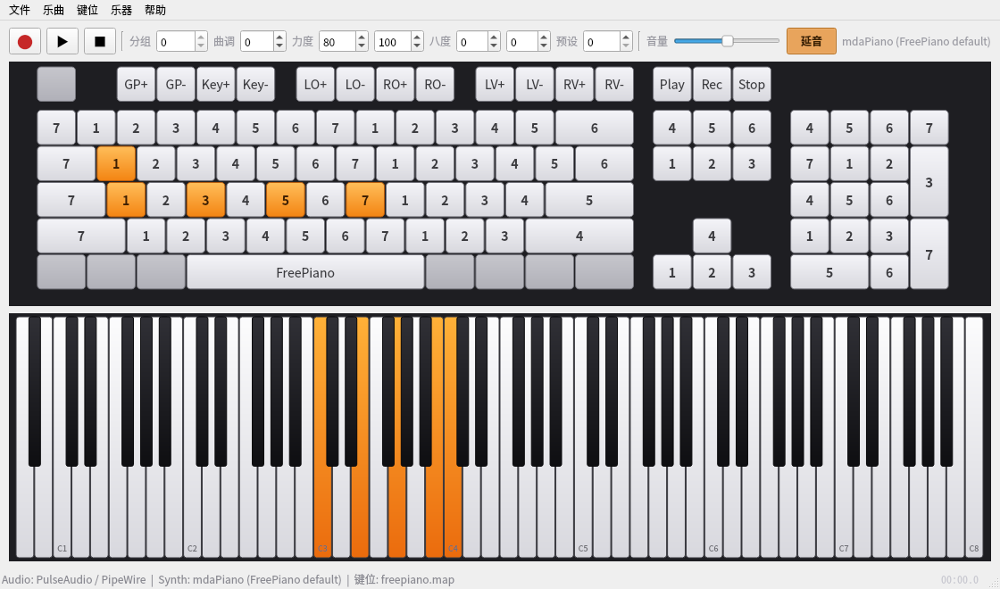
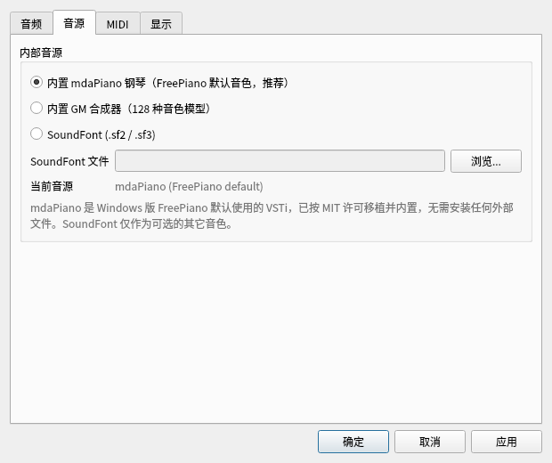
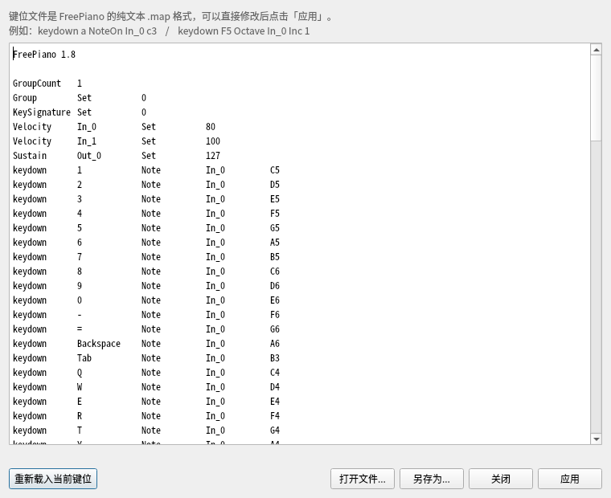
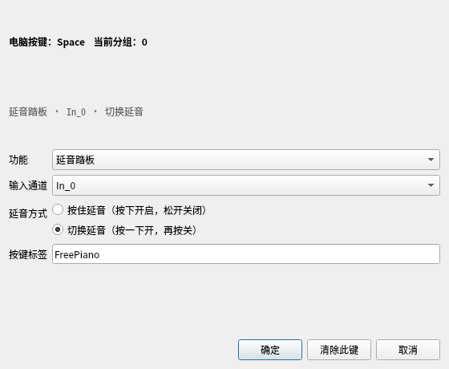

# FreePiano Linux

用电脑键盘演奏 MIDI 乐器的 **FreePiano 1.8 Linux 原生移植**。

> **关于你给的仓库**：<https://github.com/gendloop/freepiano> 只是 Windows 版的
> Scoop 分发仓库（`freepiano-$version-win64.7z` 发布包 + 打包脚本），**没有源代码**。
> 真正的上游源码是 <https://github.com/Energy0124/freepiano>（FreePiano 1.8）。
> 本移植基于上游源码的架构、键位脚本语义和文件格式重写了 Linux 平台层。



## 功能

* **键盘演奏**：屏幕上的 PC 键盘实时显示音符/功能标签，按下时高亮；下方 88 键钢琴同步显示。
* **鼠标演奏**：左键点击上方屏幕键盘或下方钢琴即可发声，按住拖动可滑奏；鼠标按键同样会录入乐曲。
* **右键改键**：右键点击屏幕键盘上的任意键，可直接修改该键在当前分组中的功能（音符、通道、八度、
  移调、延音、播放/录制等），无需手写 `.map`；延音键可选「按住延音」或「切换延音」。
* **延音按钮**：工具栏「延音」一键切换延音踏板（CC64），状态跟随键位脚本/回放同步，并会录入乐曲。
* **原版键位兼容**：直接加载 FreePiano 的 `.map` 键位文件（含 `NoteOn / Octave / Velocity /
  Transpose / KeySignature / Group / Sustain / 中文指令` 等），自带 `freepiano.map`、
  `flashpiano.map`、`idreampiano.map`、`default.map`。
* **原版乐曲兼容**：读写 FreePiano 的 `.fpm` 乐曲（zlib 压缩事件流），可与 Windows 版互相打开。
* **音源**：
  * 内置 **mdaPiano**——FreePiano Windows 版默认 VSTi 的 MIT 许可原生移植，开箱即用，
    不需要 VST、Wine 或外部 SoundFont；8 个原厂预设可在「乐器 → mdaPiano 预设」切换；
  * 内置 GM 合成器（12 种音色模型），作为通用备用音源；
  * 可选 FluidSynth + SoundFont（`.sf2` / `.sf3`），使用其它 GM 音色库。
* **音频输出**：PortAudio（ALSA/JACK）+ PulseAudio / PipeWire 后端，自动回退。
* **MIDI**：ALSA sequencer MIDI 输入（外部 MIDI 键盘，支持通道映射）与 MIDI 输出。
* **录制 / 播放 / 导出 WAV**：录制键位/延音事件，保存为 `.fpm`；可离线渲染导出 16-bit WAV。
* **多分组、移调、跟随曲调、延音、力度、八度**：与原版脚本语义一致。
* **键位编辑器**：以纯文本方式编辑 `.map`，实时应用、另存。
* 中/英文界面（按 `LANG` 自动选择，可在设置中切换）。

## 截图

| 设置 | 键位编辑器 | 右键修改按键 |
| --- | --- | --- |
|  |  |  |

## 构建

依赖：CMake ≥ 3.20、C++20 编译器、Qt 6 Widgets、PortAudio、ALSA（可选：FluidSynth、PulseAudio、
zlib、libiconv）。

**Arch / CachyOS / Manjaro**

```bash
sudo pacman -S --needed base-devel cmake ninja qt6-base portaudio alsa-lib \
     fluidsynth zlib libpulse
```

**Debian / Ubuntu**

```bash
sudo apt install build-essential cmake ninja-build qt6-base-dev portaudio19-dev \
     libasound2-dev libfluidsynth-dev zlib1g-dev libpulse-dev
```

**Fedora**

```bash
sudo dnf install gcc-c++ cmake ninja-build qt6-qtbase-devel portaudio-devel \
     alsa-lib-devel fluidsynth-devel zlib-devel pulseaudio-libs-devel
```

```bash
cmake -S . -B build -G Ninja -DCMAKE_BUILD_TYPE=Release
cmake --build build -j
./build/bin/freepiano
```

安装到系统（程序、键位、图标、`.desktop`）：

```bash
sudo cmake --install build          # 默认前缀 /usr/local
```

可选开关：`-DFP_WITH_FLUIDSYNTH=OFF`、`-DFP_WITH_PULSE=OFF`、`-DFP_WITH_MIDI=OFF`。

## 使用

* 启动后**窗口获得焦点**即可用键盘演奏（默认键位下 `Z X C V…` 为低音区，`A S D F…` 为中音区，
  `Q W E…` 和数字行为高音区；`F1/F2` 切换分组，`F3/F4` 曲调，`F5-F12` 八度/力度）。
* 左键点击上方屏幕键盘或下方钢琴都可以演奏（可按住拖动滑奏），鼠标按下的音会录入乐曲。
* 右键点击上方屏幕键盘的某个键，可修改该键在当前分组中的功能；「清除此键」可解除绑定。
  延音踏板键提供两个子选项：**按住延音**（按下开启、松开关闭）和**切换延音**（按一次开、再按关）。
* 工具栏「延音」按钮切换延音踏板（作用于 `In_0` 对应的输出通道，即默认键位），按钮状态会跟随
  键位脚本/乐曲回放更新；开启时会录入乐曲。
* `●` 录制、`▶` 播放、`■` 停止；`Ctrl+O / Ctrl+S` 打开/保存 `.fpm`，`Ctrl+E` 导出 WAV。
* 「键位」菜单可切换/编辑 `.map`；「乐器」菜单切换 mdaPiano / GM 合成器 / SoundFont，
  并可选择 mdaPiano 的 8 个预设。
* 设置中可切换音频设备、PulseAudio/PipeWire、采样率、缓冲、MIDI 端口与通道映射。

### 关于音源

默认音源就是 Windows 版 FreePiano 默认的 mdaPiano（已内置，含钢琴采样表），启动即可得到
和原版接近的钢琴声，不需要任何外部文件。若想使用别的音色：

* 「设置 → 音源」可在 mdaPiano、内置 GM 合成器、SoundFont 之间切换；
* 「乐器 → mdaPiano 预设」可选择 `Concert Piano`、`Dark Piano` 等 8 个原厂预设；
* 需要 GM 音色库时，可加载任意 `.sf2/.sf3`，例如：

```bash
sudo pacman -S soundfont-fluid        # FluidR3_GM
```

## 常见问题

**Q：我在 Wine 里运行 Windows 版 FreePiano 2，提示
`Configuration file "/home/zrx/.config/freepianorc" not writable`？**

这是 **Windows 版 FreePiano 2（Wispow）** 在 Wine 下的报错，不是本移植的报错。它尝试写
`~/.config/freepianorc`，但当前环境的家目录是只读的（只剩工作目录可写）。两种解决办法：

1. 直接用本项目的原生版，不需要 Wine：`./build/bin/freepiano`；
2. 继续用 Wine 时给 Wine 一个可写的主目录/前缀：

   ```bash
   mkdir -p ~/fp-wine/home ~/fp-wine/prefix
   HOME=~/fp-wine/home WINEPREFIX=~/fp-wine/prefix \
     wine "/path/to/freepiano/freepiano.exe"
   ```

本移植在检测到 `~/.config` 不可写时，会自动退回到可写目录（可执行文件旁的 `.config`、
数据目录或临时目录），不会弹出阻断式错误。

**Q：本移植对应哪个版本？** 上游开源的是 **FreePiano 1.8**（Energy0124/freepiano）。
`gendloop/freepiano` 只发布 **Wispow FreePiano 2.x** 的 Windows 二进制，2.x 源码未公开，
因此无法直接“编译一个 Linux 版 2.x”。本移植复用了 1.8 的事件模型、键位脚本与 `.fpm` 格式，
界面/音源/音频/MIDI 层全部重写。若需要 2.x 的界面与功能，需要在逆向其二进制后重写，属于另
一个量级的工程。

**Q：没有声音？** 检查「设置 → 音频」：优先使用 PortAudio 设备；如果系统只有 PipeWire/
PulseAudio，请选择 “PulseAudio / PipeWire (default)”。默认的 mdaPiano 是内置的，
不需要额外音色文件。

**Q：启动后没有窗口，或命令一直不返回？** 本移植在 Wayland 会话会优先使用 Wayland 平台；
如果是纯 X11/远程桌面，可显式指定：`QT_QPA_PLATFORM=xcb ./build/bin/freepiano`。
`--version` / `--help` 不依赖显示服务器，可在无显示环境直接运行。

**Q：如何在后台/其他窗口演奏？** Linux（尤其 Wayland）不允许全局抓键，本移植只在窗口聚焦时
接收键盘；这是与 Windows 低级键盘钩子的主要行为差异。

## 与 Windows 版的差异

| Windows 版 | Linux 移植 |
| --- | --- |
| VSTi 插件（默认 mdaPiano） | 内置 mdaPiano（MIT 移植）/ 可选 SoundFont |
| DirectSound / WASAPI / ASIO | PortAudio（ALSA/JACK）+ PulseAudio/PipeWire |
| WinMM MIDI 输入/输出 | ALSA sequencer |
| Direct3D 皮肤渲染 | Qt 6 原生绘制（布局与原版一致） |
| 全局低级键盘钩子（后台可弹） | 仅窗口聚焦时演奏（Wayland 不允许全局抓键） |
| 导出 MP4 | 导出 WAV（MP4 未移植） |
| 打开 iDreamPiano `.lyt` | 未移植（`.fpm` 已支持） |

## 兼容性验证

仓库自带自测，可检查键位解析、事件翻译、录音、`.fpm` 往返、分组、WAV 渲染：

```bash
./build/bin/freepiano --selftest --no-audio
./build/bin/freepiano --test-maps ./assets
./build/bin/freepiano --test-songs /path/to/freepiano/data/song
```

在开发机上使用上游自带的 12 首官方 demo（`data/song/*.fpm`）与 4 个 `.map` 验证：

* 12/12 `.fpm` 全部可打开、解析并正常播放；
* 键盘扫描码回归用例（X11 `evdev+8` 与原始 evdev 两种口径）全部通过；
* 4/4 `.map` 全部可加载（含 `flashpiano.map`、`idreampiano.map`）；
* 自测全部通过，WAV 导出非静音（mdaPiano、内置合成器与 FluidSynth 均验证）；
* UI 测试覆盖鼠标点击演奏、右键改键信号、延音按钮、改键对话框重绑定，以及延音键的
  「按住」和「切换」两种模式。

## 开发

```
src/core/   便携引擎：keycodes / config(.map) / song(.fpm) / keyboard / midi /
            synth_mda_piano（内置 mdaPiano）/ synth_builtin / fluidsynth_engine /
            audio / alsa_midi / engine / wav_export
src/ui/     Qt 6 界面：mainwindow / keyboardwidget / pianowidget / 设置 / 键位编辑器
assets/     键位、图标、desktop 文件
docs/       截图
```

更详细的重构说明见 [PORTING.md](PORTING.md)。

## 许可证

本移植及其修改遵循 **BSD 3-Clause**，与上游一致。原版 FreePiano：

```
Copyright (c) 2013, FreePiano
All rights reserved.
```

完整许可见 [LICENSE](LICENSE)。上游项目：<https://github.com/Energy0124/freepiano>。

内置的 **mdaPiano** 音源（DSP 与采样表）来自 Paul Kellett 的 mda 插件，
Copyright (c) 1999-2000 Paul Kellett，MIT 许可；许可全文见
[LICENSES/mdaPiano-MIT.txt](LICENSES/mdaPiano-MIT.txt)。

第三方组件：Qt 6 (LGPL-3.0)、PortAudio (MIT)、ALSA (LGPL-2.1)、FluidSynth (LGPL-2.1)、
zlib (zlib)、PulseAudio (LGPL-2.1)。
